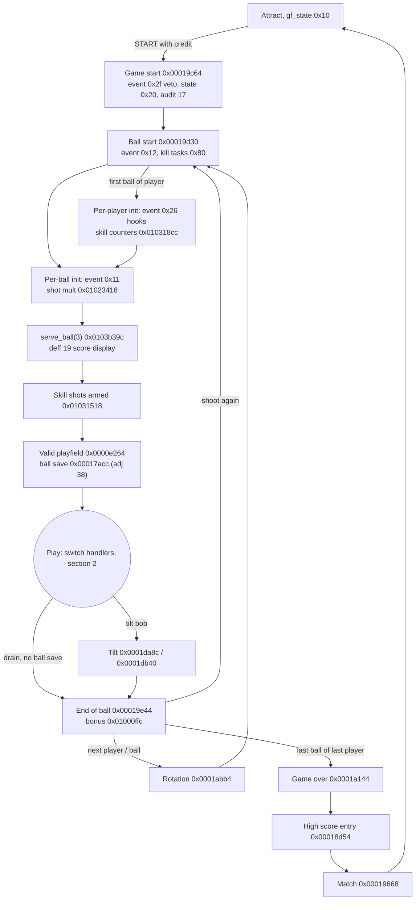
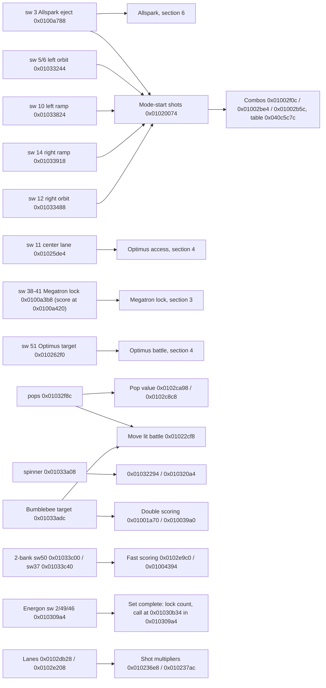
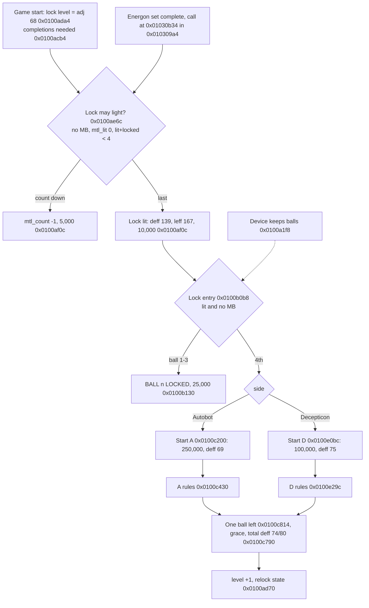
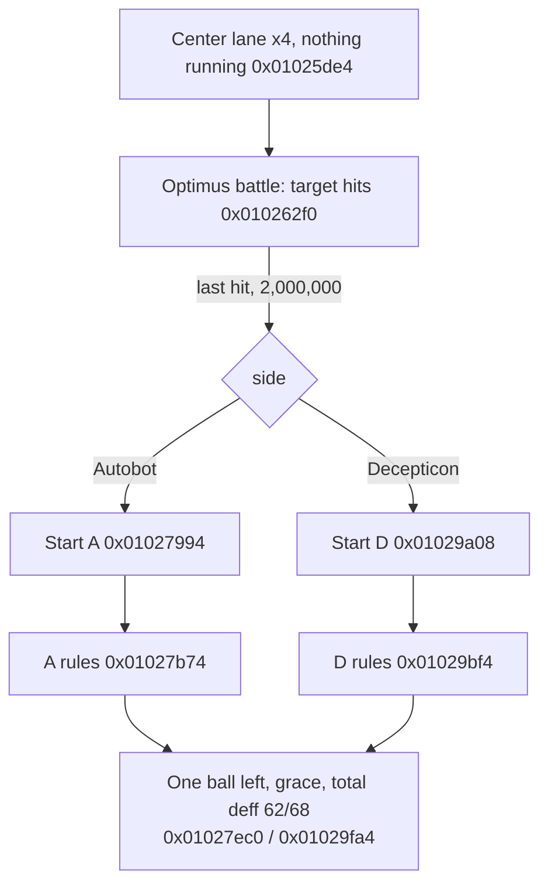
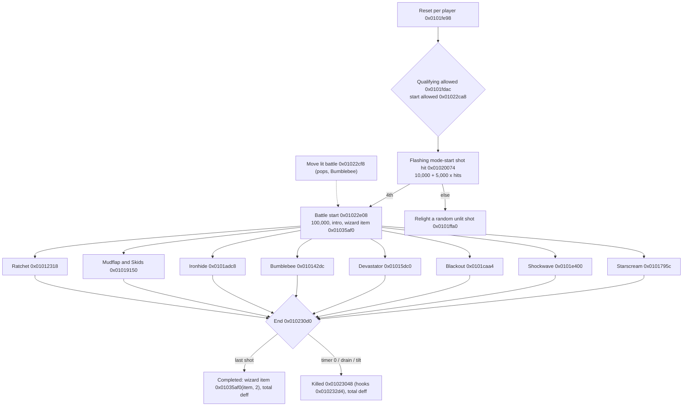
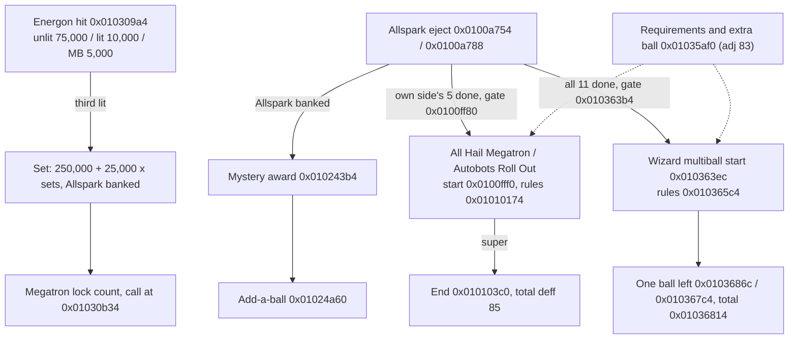
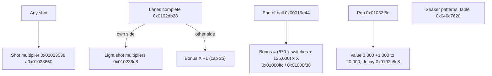

# Functional diagram: Transformers Pro 1.80 (`tf_180`), one ROM address per node

STRICT RULE item 5 ([CLAUDE.md](../CLAUDE.md)): the visual diagram of the game taken from the code, one ROM address
per node. Written 2026-11-25 by the QA pass ([docs/qa/README.md](qa/README.md)), **after** the game was coded,
from agent A's rule specs (`rom/rules/modes/*.md`); every address below is one those specs cite from
`rom/code/tf_decompiled.c`, and `tests/test_functional_diagram.py` checks that each one is a function start (or a
ROM table) in the decompile. Addresses below 0x00036000 are the SAM OS; game code starts at 0x01000000; ROM tables
at 0x040xxxxx. A node marked `?` is one the QA audit found wrong or unproven: see the QA report.

Each chart reads top to bottom: start condition, the shots' awards, completion, end. The game's code for each
part is the file named under the chart.

## 1. Game flow (OS)

Game: `game/tf/os_layer.py`, `game/tf/features/skill_shot.py`, `game/tf/features/bonus.py`, `game/tf/features/game_over.py`.

## 2. Switches to features

Game: `game/tf/switches.py` and the feature files in `game/tf/features/`.

## 3. Megatron lock and multiball

Game: `game/tf/features/megatron.py`.

## 4. Optimus battle and multiball

Game: `game/tf/features/optimus.py`, `game/tf/features/optimus_mech.py`.

## 5. Character battles

Records: ROM table 0x040c6e08 (8 x 0x28 bytes). Game: `game/tf/features/battles.py`.

## 6. Energon, Allspark, wizard modes

Game: `game/tf/features/energon.py`, `allspark.py`, `wizard.py`.

## 7. Scoring around the modes

Game: `game/tf/features/combos.py`, `lanes.py`, `bonus.py`, `pops.py`, `spinner.py`, `bumblebee.py`, `twobank.py`.

Last updated 2026-11-25.
